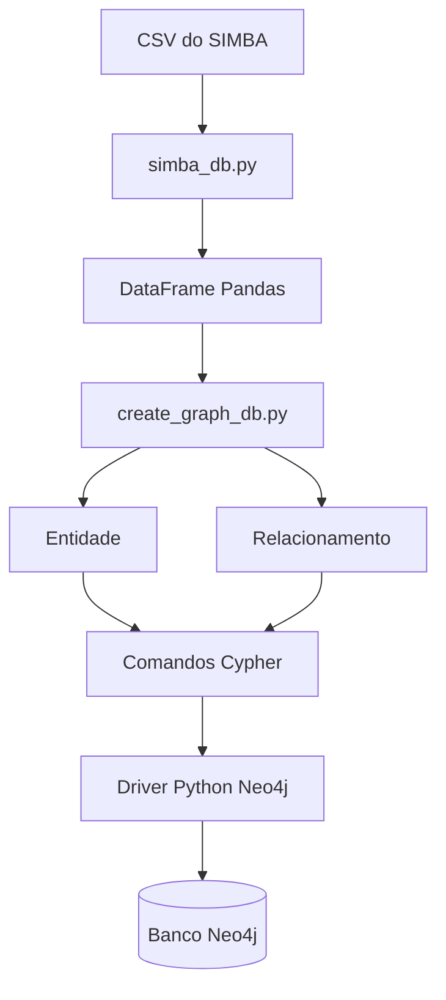

# SIMBA Graph — Modelagem de Movimentações Financeiras com Neo4j

## 📌 Sobre o projeto

O **SIMBA Graph** é um projeto Python que transforma dados de movimentações financeiras provenientes de arquivos CSV do SIMBA em uma estrutura de grafo, utilizando o banco de dados Neo4j.

A solução permite representar pessoas, contas bancárias e transações financeiras como nós, conectados por relacionamentos direcionados que representam vínculos de titularidade e fluxos financeiros.

O projeto utiliza Pandas para processar os dados, Python para gerar comandos Cypher e o driver oficial `neo4j` para executar as consultas no banco de dados.

## 🎯 Objetivos

- Importar e tratar dados financeiros de arquivos CSV.
- Padronizar datas, valores monetários e campos textuais.
- Modelar pessoas físicas e jurídicas, contas bancárias e transações.
- Gerar comandos Cypher para criação e atualização de nós e relacionamentos.
- Persistir os dados no Neo4j.
- Representar fluxos financeiros de crédito e débito.
- Facilitar a exploração de conexões entre pessoas, contas e transações.

## 🏗️ Arquitetura do projeto

A solução está organizada em três módulos Python principais e um arquivo de configuração do Docker.

| Componente | Responsabilidade |
|---|---|
| `create_graph_db.py` | Orquestra a importação, a criação das entidades e dos relacionamentos e a execução das consultas no Neo4j. |
| `simba_db.py` | Carrega o CSV do SIMBA e prepara os dados com Pandas. |
| `entidade_relacionamento.py` | Define as classes `Entidade` e `Relacionamento` e gera os comandos Cypher. |
| `docker-compose.yml` | Define o serviço Neo4j, suas portas, credenciais e volumes. |
| `.env` | Armazena as configurações de conexão e o caminho do arquivo CSV. |

### Fluxo de processamento



## 🧩 Modelo de dados

O grafo utiliza três tipos principais de nós.

| Nó | Descrição |
|---|---|
| `PESSOA` | Representa o titular ou a pessoa identificada como origem/destino. |
| `CONTA` | Representa uma conta bancária. |
| `TRANSACAO` | Representa um lançamento financeiro. |

### Relacionamentos

| Relacionamento | Finalidade |
|---|---|
| `PERTENCE` | Relaciona uma pessoa à sua conta bancária. |
| `ENVIOU` | Representa o envio de recursos. |
| `RECEBEU` | Representa o recebimento de recursos. |
| `TRANSACIONOU` | Relacionamento genérico utilizado para naturezas diferentes de `D` e `C`. |

### Direção dos fluxos financeiros

O método `create_relacionamento_transacao()` define os relacionamentos de acordo com a natureza do lançamento.

**Débito (`D`)**

A conta do titular envia recursos, e a conta de origem/destino é representada como recebedora:

```cypher
MERGE (titular)-[:ENVIOU]->(t)
MERGE (t)-[:RECEBEU]->(od)
```

**Crédito (`C`)**

A conta de origem/destino envia recursos, e a conta do titular é representada como recebedora:

```cypher
MERGE (titular)<-[:RECEBEU]-(t)
MERGE (t)<-[:ENVIOU]-(od)
```

## ⚙️ Tecnologias utilizadas

- Python 3
- Pandas
- Neo4j 5
- Driver oficial Neo4j para Python
- python-dotenv
- Docker
- Docker Compose
- Cypher

## 📋 Pré-requisitos

Antes de executar o projeto, instale ou disponibilize:

1. Python 3.
2. Docker Engine ou Docker Desktop com Docker Compose.
3. Um arquivo CSV exportado do SIMBA.
4. As dependências Python do projeto.

## 📂 Estrutura sugerida

```text
simba-graph/
├── create_graph_db.py
├── simba_db.py
├── entidade_relacionamento.py
├── docker-compose.yml
├── requirements.txt
├── .env
├── .env.example
└── .gitignore
```

## 🚀 Instalação e configuração

### 1. Criar um ambiente virtual

No Windows, utilizando PowerShell:

```powershell
python -m venv .venv
.\.venv\Scripts\Activate.ps1
```

No Linux:

```bash
python3 -m venv .venv
source .venv/bin/activate
```

### 2. Instalar as dependências


```bash
pip install -r requirements.txt
```

## 🐳 Configuração do Neo4j com Docker Compose

O arquivo `docker-compose.yml` define um contêiner Neo4j 5, com acesso à interface web e ao protocolo Bolt.

Exemplo de configuração:

```yaml
services:
  neo4j:
    image: neo4j:5
    container_name: neo4j
    restart: unless-stopped

    ports:
      - "7474:7474"
      - "7687:7687"

    environment:
      NEO4J_AUTH: "${NEO4J_USER}/${NEO4J_PASSWORD}"

    volumes:
      - "${NEO4J_DATA_PATH}:/data"
      - "${NEO4J_LOGS_PATH}:/logs"
      - "${NEO4J_PLUGINS_PATH}:/plugins"
```

Os diretórios devem existir no host e ser acessíveis pelo Docker. Ajuste os caminhos de acordo com o sistema operacional.

**Importante:** no Windows, os caminhos absolutos devem ser configurados de acordo com o ambiente do Docker Desktop. No Linux, utilize diretórios persistentes apropriados para o servidor.

O diretório `/data` contém os dados persistentes do banco. Os diretórios de logs e plugins são opcionais conforme a necessidade de operação.

### Iniciar o contêiner

```bash
docker compose up -d
```

Verificar o estado:

```bash
docker compose ps
```

Consultar os logs:

```bash
docker compose logs -f neo4j
```

A interface web estará disponível em:

- Neo4j Browser: `http://localhost:7474`
- Bolt: `bolt://localhost:7687`

A configuração inicial de autenticação deverá ser realizada com o usuário e a senha definidos no Compose.

## 🔐 Configuração das variáveis de ambiente

Crie um arquivo `.env` na raiz do projeto:

```dotenv
URI=neo4j://localhost:7687
AUTH_BASE=neo4j
AUTH_PASSWORD=troque_por_uma_senha_forte
PATH_DATABASE_SIMBA=./dados/dados_simba.csv

```

Ajuste `PATH_DATABASE_SIMBA` para apontar para o CSV real.

As variáveis `AUTH_BASE` e `AUTH_PASSWORD` são utilizadas pelo script Python. Já `NEO4J_USER` e `NEO4J_PASSWORD` são utilizadas pelo Docker Compose. Os valores correspondentes precisam ser consistentes.

O endereço `bolt://localhost:7687` pressupõe que o Python seja executado no mesmo computador que publica a porta do Neo4j. Se o script estiver em outro contêiner, `localhost` deverá ser substituído pelo nome do serviço na rede Docker, como `neo4j`.

## 📥 Importação e tratamento dos dados

A classe `Simba`, implementada em `simba_db.py`, carrega os dados do arquivo CSV utilizando Pandas.

A leitura utiliza:

- Separador `;`.
- Codificação `ISO-8859-1`.
- Engine `python`.
- Descarte de linhas malformadas por meio de `on_bad_lines='skip'`.

A coluna `DATA_LANCAMENTO` é convertida para datetime usando o formato `%d/%m/%Y`.

As colunas `VALOR_TRANSACAO` e `VALOR_SALDO` são convertidas para valores numéricos após a substituição da vírgula decimal por ponto.

As demais colunas são convertidas para strings.

O método `get_dataframe()` retorna o DataFrame tratado.

## 🧠 Classe `Entidade`

A classe `Entidade`, implementada em `entidade_relacionamento.py`, recebe os dados de um registro e gera comandos Cypher para os nós do grafo.

### Métodos de geração de nós

- `sintaxe_cypher_conta_titular()`
- `sintaxe_cypher_conta_od()`
- `sintaxe_cypher_transacao()`
- `sintaxe_cypher_pessoa_titular()`
- `sintaxe_cypher_pessoa_od()`

### Identificação das contas

As contas são identificadas pela composição de banco, agência e número da conta, com preenchimento de zeros à esquerda:

```text
BANCO-AGENCIA-CONTA
```

### Identificação das pessoas

O identificador de pessoa deriva do CPF/CNPJ, tratado para remover espaços e o sufixo `.0`, com preenchimento até 14 caracteres.

### Identificação das transações

A chave da transação é formada a partir de campos como CNAB, data, valor, natureza do lançamento e saldo.

Os comandos utilizam `MERGE` e `ON CREATE SET` para criar os nós quando ainda não existem.

## 🔗 Classe `Relacionamento`

A classe `Relacionamento` gera comandos para conectar os nós:

- `create_relacionamento_transacao()`
- `create_relacionamento_pessoa_titular_conta()`
- `create_relacionamento_pessoa_od_conta()`

O método `create_relacionamento_transacao()` utiliza a natureza do lançamento para estabelecer a direção dos relacionamentos financeiros.

## ▶️ Execução do projeto

Após configurar o ambiente, o banco de dados e o arquivo `.env`, execute:

```bash
python create_graph_db.py
```

O script realiza as seguintes operações:

1. Carrega as variáveis de ambiente com `load_dotenv()`.
2. Cria o driver de conexão com o Neo4j.
3. Instancia a classe `Simba`.
4. Obtém o DataFrame com os dados tratados.
5. Percorre os registros com `iterrows()`.
6. Cria uma instância de `Entidade` para cada linha.
7. Gera os comandos Cypher para pessoas, contas e transações.
8. Gera os comandos Cypher para os relacionamentos.
9. Combina os comandos em uma única consulta.
10. Executa a consulta no Neo4j.
11. Registra no terminal eventuais exceções de execução.

O script imprime informações sobre o DataFrame, os comandos gerados e os erros encontrados durante a execução.

## 🔎 Exemplos de consultas no Neo4j

### Consultar pessoas

```cypher
MATCH (p:PESSOA)
RETURN p
LIMIT 100;
```

### Consultar contas bancárias

```cypher
MATCH (c:CONTA)
RETURN c
LIMIT 100;
```

### Consultar transações

```cypher
MATCH (t:TRANSACAO)
RETURN t
ORDER BY t.data_lancamento DESC
LIMIT 100;
```

### Visualizar os relacionamentos do grafo

```cypher
MATCH (a)-[r]->(b)
RETURN a, r, b
LIMIT 100;
```

### Consultar o fluxo de débito

```cypher
MATCH (titular:CONTA)-[:ENVIOU]->(t:TRANSACAO)-[:RECEBEU]->(destino:CONTA)
RETURN
    titular.id AS conta_origem,
    destino.id AS conta_destino,
    t.data_lancamento AS data,
    t.valor_transacao AS valor,
    t.numero_caso AS caso
ORDER BY data;
```

A consulta depende de os nós e relacionamentos terem sido criados de acordo com o modelo implementado.

## 🔒 Segurança, integridade e qualidade dos dados

Como o projeto trata informações financeiras e dados pessoais, recomenda-se:

- Não versionar arquivos CSV reais, credenciais ou dados pessoais no Git.
- Restringir as portas do banco à rede necessária, especialmente em servidores.

### Exemplo de `.gitignore`

```gitignore
# Ambiente virtual
.venv/
venv/

# Segredos
.env
.env.*

# Permite versionar apenas o modelo de configuração
!.env.example

# Dados financeiros
dados/
*.csv
*.xlsx

# Persistência local do Neo4j
neo4j/data/
neo4j/logs/
neo4j/plugins/

# Python
__pycache__/
*.py[cod]

# Configurações locais de editores
.vscode/
```

Revise as regras de exclusão para não ignorar arquivos CSV de exemplo que sejam fictícios e apropriados para testes.

---

**Observação:** o grafo representa os vínculos derivados dos dados de origem e das regras de modelagem implementadas. Um relacionamento identificado não constitui, isoladamente, prova de irregularidade ou responsabilidade.